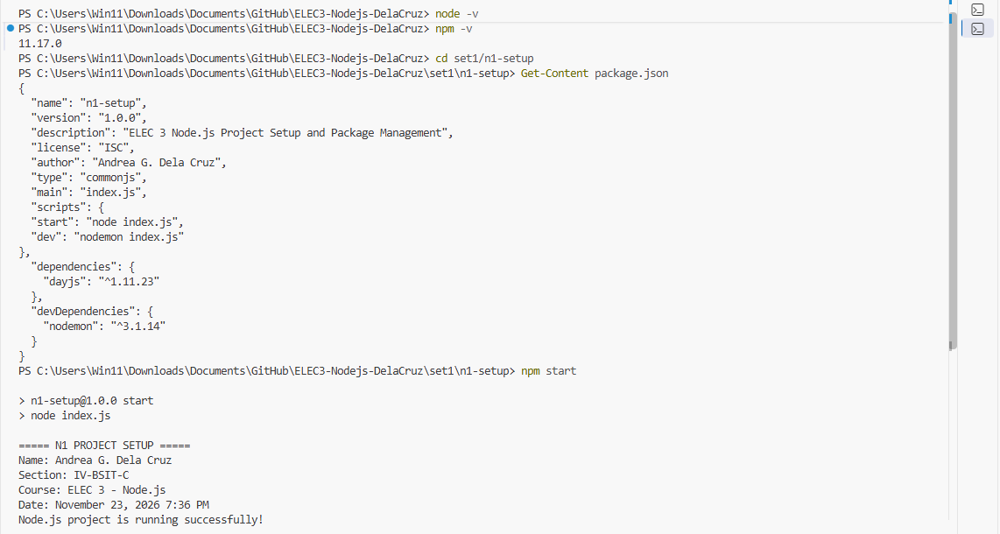
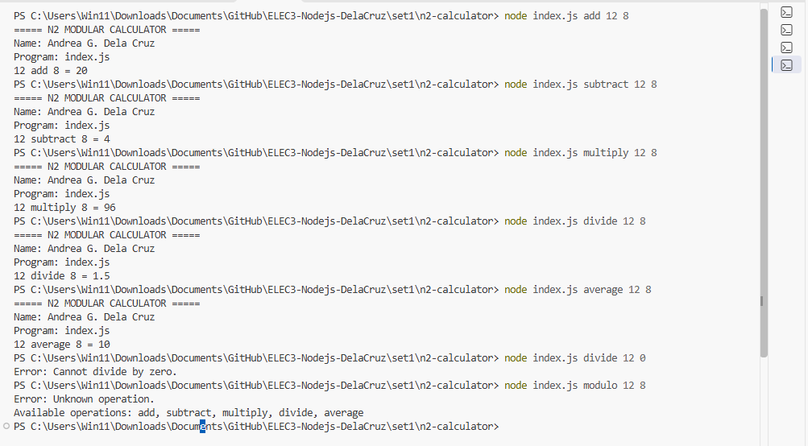
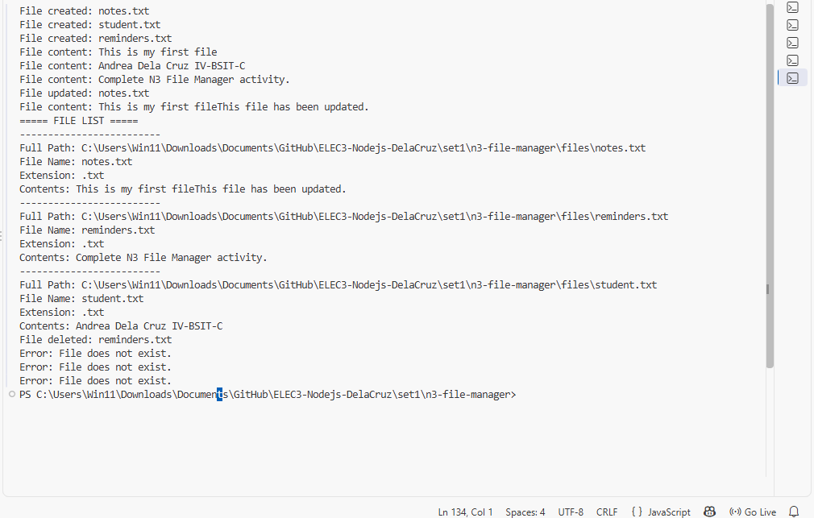

# ELEC3-Nodejs-DelaCruz

## ELEC 3 - Node.js Programming Activities

**Name:** Andrea G. Dela Cruz  
**Section:** IV-BSIT-C  
**Course:** ELEC 3  
**Course Title:** Node.js Programming

---

## Set 1 – Node.js Activities

### N1 – Project Setup and Package Management

This activity focuses on setting up a Node.js project, initializing npm, installing packages, and understanding package management.

**Folder:** [N1 Setup](set1/n1-setup/)

**Run Command:**
```bash
cd set1/n1-setup
npm start
```

**Screenshot:**



---

### N2 – Modular Calculator

This activity demonstrates the use of Node.js modules by creating a calculator with separate operation and formatter modules. It uses `require()`, `module.exports`, command-line arguments, and the built-in `path` module.

**Folder:** [N2 Calculator](set1/n2-calculator/)

**Run Commands:**
```bash
cd set1/n2-calculator

node index.js add 12 8
node index.js subtract 12 8
node index.js multiply 12 8
node index.js divide 12 8
node index.js average 12 8
node index.js divide 12 0
node index.js modulo 12 8
```

**Screenshot:**



---

### N3 – File Manager with fs and path

This activity demonstrates file management using Node.js built-in `fs` and `path` modules. It supports creating, reading, updating, deleting, and listing files and directories.

**Folder:** [N3 File Manager](set1/n3-file-manager/)

**Run Command:**
```bash
cd set1/n3-file-manager
node index.js
```

**Screenshot:**



---

## Set 2 – Node.js Activities

### N4 – Basic HTTP Server

This activity demonstrates how to create a basic HTTP server using Node.js built-in `http` module. It handles different routes such as Home, About, and Contact, including a 404 response for unavailable routes.

**Folder:** [N4 Server](set2/n4-server/)

**Run Command:**
```bash
node set2/n4-server/index.js
```

**Screenshots:**

- [Home Page](set2/n4-server/screenshots/N4_01_Home_Page.png)
- [About Page](set2/n4-server/screenshots/N4_02_About_Page.png)
- [Contact Page](set2/n4-server/screenshots/N4_03_Contact_Page.png)
- [404 Page](set2/n4-server/screenshots/N4_04_404_Page.png)

---

### N5 – REST API

This activity demonstrates how to build a REST-style API using Node.js built-in `http` module. It performs CRUD operations on student records through GET, POST, PUT, and DELETE requests.

**Folder:** [N5 API](set2/n5-api/)

**Run Command:**
```bash
node set2/n5-api/index.js
```

**API Endpoints:**

| Method | Endpoint | Description |
|---|---|---|
| GET | `/api/students` | Retrieve all students |
| GET | `/api/students/:id` | Retrieve a student by ID |
| POST | `/api/students` | Add a new student |
| PUT | `/api/students/:id` | Update a student |
| DELETE | `/api/students/:id` | Delete a student |

**Screenshots:**

- [GET All Students 1](set2/n5-api/screenshots/N5_01_GET_All_Students_1.png)
- [GET All Students 2](set2/n5-api/screenshots/N5_01_GET_All_Students_2.png)
- [GET Student by ID](set2/n5-api/screenshots/N5_02_GET_Student_By_ID.png)
- [POST Add Student](set2/n5-api/screenshots/N5_03_POST_Add_Student.png)
- [PUT Update Student](set2/n5-api/screenshots/N5_04_PUT_Update_Student.png)
- [DELETE Student](set2/n5-api/screenshots/N5_05_DELETE_Student.png)
- [Final Students 1](set2/n5-api/screenshots/N5_06_GET_Final_Students_1.png)
- [Final Students 2](set2/n5-api/screenshots/N5_06_GET_Final_Students_2.png)

---

### N6 – Middleware

This activity demonstrates the use of custom middleware in a Node.js REST API. It includes a logger middleware that records the request date, time, method, and URL, and a JSON middleware that sets the response Content-Type to `application/json`. Both middleware functions pass control to the next function using `next()`.

**Folder:** [N6 Middleware](set2/n6-middleware/)

**Run Command:**
```bash
node set2/n6-middleware/index.js
```

**API Endpoints:**

| Method | Endpoint | Description |
|---|---|---|
| GET | `/api/students` | Retrieve all students |
| GET | `/api/students/:id` | Retrieve a student by ID |
| POST | `/api/students` | Add a new student |
| PUT | `/api/students/:id` | Update a student |
| DELETE | `/api/students/:id` | Delete a student |

**Screenshots:**

- [GET All Students 1](set2/n6-middleware/screenshots/N6_01_GET_All_Students_1.png)
- [GET All Students 2](set2/n6-middleware/screenshots/N6_01_GET_All_Students_2.png)
- [GET Student by ID](set2/n6-middleware/screenshots/N6_02_GET_Student_By_ID.png)
- [POST Add Student](set2/n6-middleware/screenshots/N6_03_POST_Add_Student.png)
- [PUT Update Student](set2/n6-middleware/screenshots/N6_04_PUT_Update_Student.png)
- [DELETE Student](set2/n6-middleware/screenshots/N6_05_DELETE_Student.png)
- [Middleware Logs 1](set2/n6-middleware/screenshots/N6_06_Middleware_Logs_1.png)
- [Middleware Logs 2](set2/n6-middleware/screenshots/N6_06_Middleware_Logs_2.png)

**N6 Answers:** [N6 Answers Document](set2/n6-middleware/N6_answers.docx)

---

## Author

**Andrea G. Dela Cruz**  
**IV-BSIT-C**  
**ELEC 3 – Node.js Programming**
